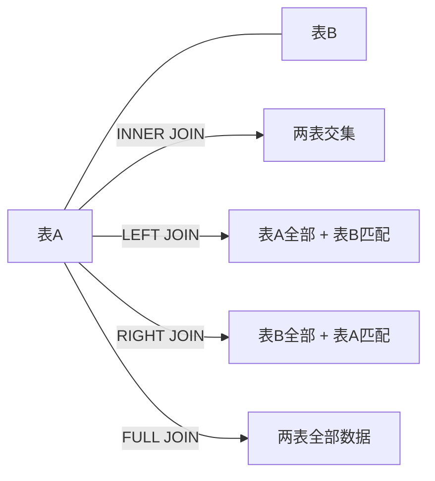

# MySQL多表查询

多表查询分为 **INNER JOIN**（内联结）和 **OUTER JOIN**（外联结）。**OUTER JOIN** 包括 **LEFT JOIN**、**RIGHT JOIN**、**FULL JOIN**。根据具体需要进行选择。

## 联结类型

| 联结类型 | 关键字 | 说明 |
|---------|--------|------|
| 左联结 | `LEFT JOIN` | 联结结果保留左表的全部数据 |
| 右联结 | `RIGHT JOIN` | 联结结果保留右表的全部数据 |
| 内联结 | `INNER JOIN` | 取两表的公共数据 |
| 完全联结 | `FULL JOIN` | 只要其中某个表存在匹配，就会返回行 |

## 基本语法

```sql
-- 内联结
SELECT 列名
FROM 表1
INNER JOIN 表2
ON 表1.列名 = 表2.列名;

-- 左联结
SELECT 列名
FROM 表1
LEFT JOIN 表2
ON 表1.列名 = 表2.列名;

-- 右联结
SELECT 列名
FROM 表1
RIGHT JOIN 表2
ON 表1.列名 = 表2.列名;

-- 完全联结
SELECT 列名
FROM 表1
FULL JOIN 表2
ON 表1.列名 = 表2.列名;
```

## 联结关系示意


