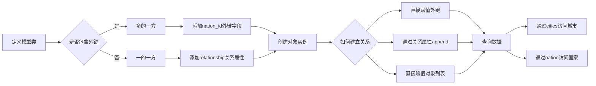

# SQLAlchemy 一对多关系

在数据库设计中，**一对多关系**是一种常见的关系类型。在这种关系中，"一"的一方可以关联到"多"的一方的多个记录，但"多"的一方只能关联到"一"的一方的一个记录。

例如，在城市和国家的模型中，一个国家可以有多个城市，但一个城市只能属于一个国家。在这种情况下，国家是"一"的一方，城市是"多"的一方。

在"一"类中添加一个关系属性作为**集合属性**，当调用这个属性时返回所有相关的对象。

## 定义基础模型

```python
# 定义 City 模型类，继承自 db.Model
# 这个类映射到数据库中的 city 表
# 每个城市都属于一个国家，通过外键 nation_id 关联
class City(db.Model):
    """城市模型"""
    # 指定表名为 'city'
    __tablename__ = 'city'
    # 定义 id 字段，整数类型，设为主键
    # 主键用于唯一标识每一条记录
    id = db.Column(db.Integer, primary_key=True)
    # 定义 name 字段，字符串类型，最大长度50，设置唯一约束
    # unique=True 表示城市名称在数据库中不能重复
    name = db.Column(db.String(50), unique=True)
    
# 定义 Nation 模型类，继承自 db.Model
# 这个类映射到数据库中的 nation 表
# 每个国家可以拥有多个城市
class Nation(db.Model):
    """国家模型"""
    # 指定表名为 'nation'
    __tablename__ = 'nation'
    # 定义 id 字段，整数类型，设为主键
    # 主键用于唯一标识每一个国家
    id = db.Column(db.Integer, primary_key=True)
    # 定义 nation_name 字段，字符串类型，最大长度50，设置唯一约束
    # unique=True 表示国家名称在数据库中不能重复
    nation_name = db.Column(db.String(50), unique=True)
```

需要实现一个国家对应多个城市。

### 建立一对多关系

**第一步：** 在"多"的一侧创建**外键**。

```python
class City(db.Model):
    """城市模型"""
    __tablename__ = 'city'
    id = db.Column(db.Integer, primary_key=True)
    name = db.Column(db.String(50), unique=True)
    # 外键指向 nation 表的 id 字段
    # db.ForeignKey('nation.id') 指定外键约束，关联到 nation 表的 id 字段
    # 通过这个外键，建立了城市到国家的多对一关系
    nation_id = db.Column(db.Integer, db.ForeignKey('nation.id'))
    # 注意：nation.id 中的表名是小写（因为 SQLAlchemy 生成的表默认为类名的小写形式）
```

**第二步：** 在"一"的一侧定义关系属性（集合关系属性，列表）。

```python
class Nation(db.Model):
    """国家模型"""
    __tablename__ = 'nation'
    id = db.Column(db.Integer, primary_key=True)
    nation_name = db.Column(db.String(50), unique=True)
    # 定义一对多关系，一个国家可以有多个城市
    # 'City' 指定关联的模型类
    # backref='nation' 在 City 模型中自动创建 nation 属性，实现反向引用
    # 通过 cities 属性可以访问该国家的所有城市
    cities = db.relationship('City', backref='nation')
```

当关系属性 `nation.cities` 被调用时，**SQLAlchemy** 会找到 `city 表`的**外键**字段（`nation_id`），然后查询 `city 表`中 `nation_id` 为当前主键值（`nation.id`）的记录，返回包含这些记录的列表。

**需要注意的是**，使用关系函数定义的集合关系属性不是数据库字段，而是一个查询函数。所以返回值并不固定，而是根据查询结果动态变化。

### relationship 函数常用参数说明

`relationship` 函数有许多参数可以用来定制关系的行为，以下是几个常用的参数：

**1. `backref` 参数**：在一对多关系中，可以在"一"的一侧使用 `backref` 参数自动在"多"的一侧创建反向引用。

```python
class Nation(db.Model):
    """国家模型"""
    __tablename__ = 'nation'
    id = db.Column(db.Integer, primary_key=True)
    nation_name = db.Column(db.String(50), unique=True)
    # 使用 backref 参数创建双向关系
    # 'City' 指定关联的模型类
    # backref='nation' 在 City 模型中自动创建 nation 属性，实现反向引用
    # 通过 cities 属性可以访问该国家的所有城市
    cities = db.relationship('City', backref='nation')
```

这样，在 `City` 模型中就自动有了一个 `nation` 属性，可以直接访问该城市的所属国家。

**2. `lazy` 参数**：控制关联对象的加载方式。

```python
class Nation(db.Model):
    """国家模型"""
    __tablename__ = 'nation'
    id = db.Column(db.Integer, primary_key=True)
    nation_name = db.Column(db.String(50), unique=True)
    # 使用 lazy 参数控制加载方式
    # lazy='select' 指定加载方式为 select 模式（默认）
    # select 模式会在访问 cities 属性时发出新的 SELECT 语句加载数据
    cities = db.relationship('City', backref='nation', lazy='select')
```

**3. `cascade` 参数**：控制级联操作行为。

```python
class Nation(db.Model):
    """国家模型"""
    __tablename__ = 'nation'
    id = db.Column(db.Integer, primary_key=True)
    nation_name = db.Column(db.String(50), unique=True)
    # 使用 cascade 参数控制级联操作
    # cascade='all, delete-orphan' 指定级联操作为全部操作，并删除孤儿对象
    # 当删除国家时，所有关联的城市也会被删除
    # 当城市不再关联到任何国家时，城市记录也会被删除
    cities = db.relationship('City', backref='nation', cascade='all, delete-orphan')
```

### 创建和使用对象

创建国家和城市对象：

```python
# 创建国家对象
china = Nation(nation_name='中国')
usa = Nation(nation_name='美国')

# 将国家对象添加到数据库会话中
db.session.add(china)
db.session.add(usa)
# 提交会话，将国家对象保存到数据库
db.session.commit()

# 创建城市对象，通过 nation 参数直接关联到对应的国家对象
beijing = City(name='北京', nation=china)
shanghai = City(name='上海', nation=china)
new_york = City(name='纽约', nation=usa)

# 将城市对象添加到数据库会话中
db.session.add(beijing)
db.session.add(shanghai)
db.session.add(new_york)
# 提交会话，将城市对象保存到数据库
db.session.commit()
```

### 查询关系数据

通过关系属性查询数据：

```python
# 查询国家对象
china = Nation.query.filter_by(nation_name='中国').first()
print(f"{china.nation_name}的城市有:")
# 遍历 cities 关系属性，获取所有关联的城市对象
for city in china.cities:
    print(f"- {city.name}")

# 查询城市对象
beijing = City.query.filter_by(name='北京').first()
# 通过 backref 自动创建的 nation 属性获取关联的国家对象
print(f"{beijing.name}属于{beijing.nation.nation_name}")
```

### 建立关系的方式

**方式1：** 直接通过**外键**字段赋值。

```python
# 直接为 city 对象的 nation_id 外键字段赋值，关联到 ID 为1的国家
city.nation_id = 1
db.session.commit()
```

**方式2：** 通过关系属性添加。

```python
# 通过 nation 对象的 cities 关系属性添加城市对象
# append() 方法会将对象添加到关联的城市列表中
# 同时会自动设置外键字段
nation.cities.append(beijing)  # beijing 为 City 对象
db.session.commit()
```

**方式3：** 直接将一个**对象列表**赋值给关系属性。

```python
# 直接将对象列表赋值给 cities 关系属性
# 这种方式会替换原有的所有关联关系
nation.cities = [beijing, shanghai]  # beijing 和 shanghai 均为 City 对象
db.session.commit()
```

---

### 建立双向关系

通过在 `relationship` 中使用 `backref` 参数，我们已经建立了双向关系：

```python
class Nation(db.Model):
    """国家模型"""
    __tablename__ = 'nation'
    id = db.Column(db.Integer, primary_key=True)
    nation_name = db.Column(db.String(50), unique=True)
    # 定义一对多关系，backref 参数自动在 City 模型中创建 nation 属性
    cities = db.relationship('City', backref='nation')

class City(db.Model):
    """城市模型"""
    __tablename__ = 'city'
    id = db.Column(db.Integer, primary_key=True)
    name = db.Column(db.String(50), unique=True)
    # 外键指向 nation 表的 id 字段
    nation_id = db.Column(db.Integer, db.ForeignKey('nation.id'))
```

这样就建立了双向关系：

- 通过 `nation.cities` 可以获取该国家的所有城市
- 通过 `city.nation` 可以获取该城市所属的国家

下面是一对多关系操作的流程图：



使用示例：

```python
# 查询国家对象
china = Nation.query.filter_by(nation_name='中国').first()
print(f"{china.nation_name}的城市有:")
# 遍历 cities 关系属性，获取所有关联的城市对象
for city in china.cities:
    print(f"- {city.name}")

# 查询城市对象
beijing = City.query.filter_by(name='北京').first()
# 通过 backref 自动创建的 nation 属性获取关联的国家对象
print(f"{beijing.name}属于{beijing.nation.nation_name}")
```

## 核心要点总结

- **一对多关系**："一"的一方可以关联"多"的一方的多个记录，"多"的一方只能关联"一"的一方的一个记录
- **外键**：在"多"的一侧创建，指向"一"的一侧的主键，建立数据关联
- **relationship 函数**：在"一"的一侧定义，用于建立对象间的关系，非数据库字段
- **backref 参数**：**最佳实践**，自动在"多"的一侧创建反向引用，实现双向关系
- **lazy 参数**：**最佳实践**，控制关联对象加载方式，优化查询性能
- **cascade 参数**：**最佳实践**，控制级联操作行为，确保数据一致性
