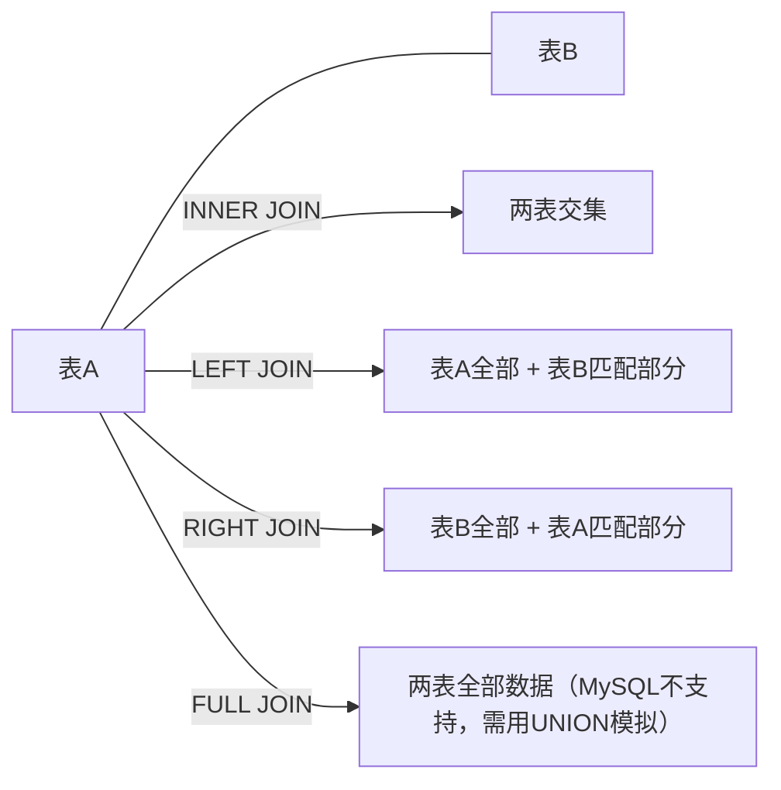

# MySQL多表查询

多表查询是关系型数据库中的核心操作，主要分为**INNER JOIN**（内连接）和**OUTER JOIN**（外连接）两大类。其中**OUTER JOIN**又包括**LEFT JOIN**、**RIGHT JOIN**和**FULL JOIN**，不过MySQL并不支持FULL JOIN。

## 连接类型

| 连接类型 | 关键字 | 说明 |
|---------|--------|------|
| 左连接 | `LEFT JOIN` | 保留左表的全部记录，右表无匹配时以NULL填充 |
| 右连接 | `RIGHT JOIN` | 保留右表的全部记录，左表无匹配时以NULL填充 |
| 内连接 | `INNER JOIN` | 仅返回两表中满足连接条件的公共记录 |
| 全连接 | `FULL JOIN` | 返回两表的全部记录，无匹配的一侧以NULL填充（MySQL不支持，需用UNION模拟） |

## 基本语法

```sql
-- 内连接
SELECT 列名
FROM 表1
INNER JOIN 表2
ON 表1.列名 = 表2.列名;

-- 左连接
SELECT 列名
FROM 表1
LEFT JOIN 表2
ON 表1.列名 = 表2.列名;

-- 右连接
SELECT 列名
FROM 表1
RIGHT JOIN 表2
ON 表1.列名 = 表2.列名;

-- 全连接：MySQL不支持FULL JOIN，用LEFT JOIN与RIGHT JOIN经UNION模拟
SELECT 列名
FROM 表1
LEFT JOIN 表2
ON 表1.列名 = 表2.列名
UNION
SELECT 列名
FROM 表1
RIGHT JOIN 表2
ON 表1.列名 = 表2.列名;
```

## 连接关系示意


