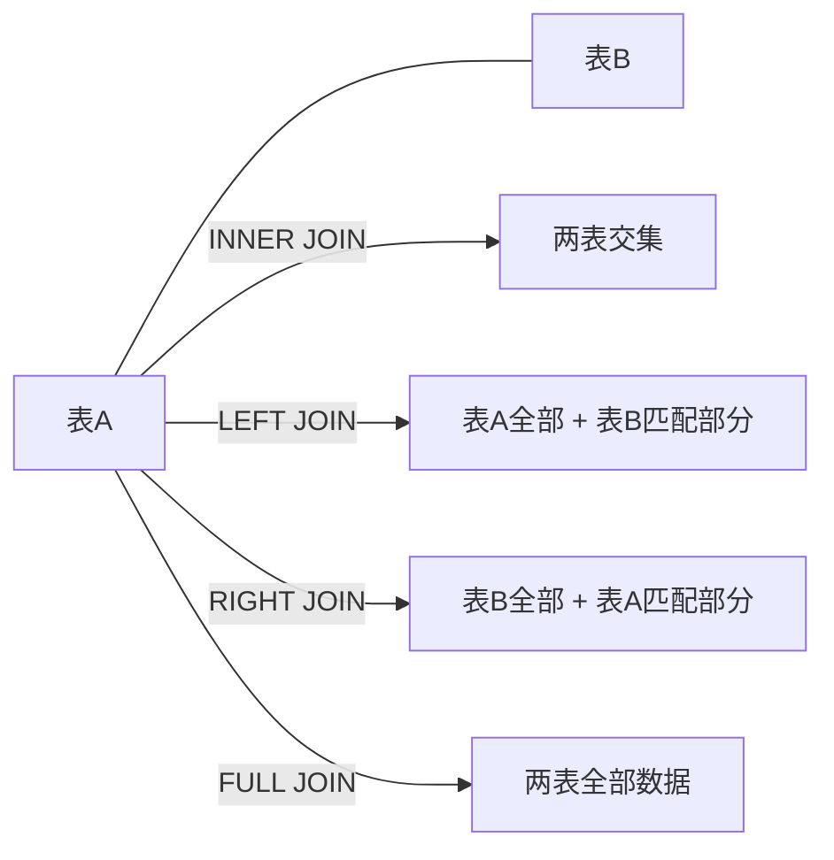

# MySQL多表查询

多表查询是关系型数据库中的核心操作，主要分为 **INNER JOIN**（内连接）和 **OUTER JOIN**（外连接）两大类。其中 **OUTER JOIN** 又包括 **LEFT JOIN**、**RIGHT JOIN** 和 **FULL JOIN**，可根据实际业务需求灵活选择。

## 联结类型

| 连接类型 | 关键字 | 说明 |
|---------|--------|------|
| 左连接 | `LEFT JOIN` | 保留左表的全部记录，右表无匹配时以 NULL 填充 |
| 右连接 | `RIGHT JOIN` | 保留右表的全部记录，左表无匹配时以 NULL 填充 |
| 内连接 | `INNER JOIN` | 仅返回两表中满足连接条件的公共记录 |
| 全连接 | `FULL JOIN` | 返回两表的全部记录，无匹配的一侧以 NULL 填充 |

## 基本语法

```sql
-- 内联结
SELECT 列名
FROM 表1
INNER JOIN 表2
ON 表1.列名 = 表2.列名;

-- 左联结
SELECT 列名
FROM 表1
LEFT JOIN 表2
ON 表1.列名 = 表2.列名;

-- 右联结
SELECT 列名
FROM 表1
RIGHT JOIN 表2
ON 表1.列名 = 表2.列名;

-- 完全联结
SELECT 列名
FROM 表1
FULL JOIN 表2
ON 表1.列名 = 表2.列名;
```

## 连接关系示意


