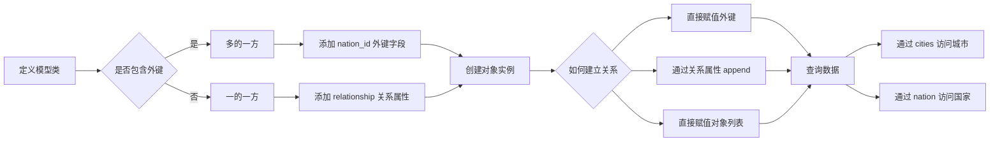

# SQLAlchemy 一对多关系完整指南：模型定义、关系建立与数据操作

在数据库设计中，**一对多关系**是最常见的关系类型之一。在这种关系中，"一"的一方可以关联"多"的一方的多条记录，而"多"的一方只能关联"一"的一方的单条记录。

以城市与国家为例：一个国家可以拥有多个城市，但每个城市只能属于一个国家。其中国家是"一"的一方，城市是"多"的一方。

在 SQLAlchemy 中，实现一对多关系需要在"一"的一方添加一个**集合关系属性**，访问该属性时将返回所有关联对象的列表。

下面以城市和国家模型为例，介绍完整的一对多关系实现。

## 定义基础模型

首先定义两个基础模型类 `City` 和 `Nation`，此时尚未建立关联关系：

```python
class City(db.Model):
    """城市模型"""
    __tablename__ = 'city'
    id = db.Column(db.Integer, primary_key=True)
    name = db.Column(db.String(50), unique=True)

class Nation(db.Model):
    """国家模型"""
    __tablename__ = 'nation'
    id = db.Column(db.Integer, primary_key=True)
    nation_name = db.Column(db.String(50), unique=True)
```

目标：实现一个国家对应多个城市的一对多关系。

## 建立一对多关系

建立一对多关系分为两步：在"多"的一侧添加外键，在"一"的一侧定义关系属性。

### 第一步：在"多"的一侧创建外键

```python
class City(db.Model):
    """城市模型"""
    __tablename__ = 'city'
    id = db.Column(db.Integer, primary_key=True)
    name = db.Column(db.String(50), unique=True)
    # 外键指向 nation 表的 id 字段，建立城市到国家的多对一关系
    nation_id = db.Column(db.Integer, db.ForeignKey('nation.id'))
    # 注意：nation.id 中的表名使用小写，因为 SQLAlchemy 默认将类名转为小写作为表名
```

### 第二步：在"一"的一侧定义关系属性

```python
class Nation(db.Model):
    """国家模型"""
    __tablename__ = 'nation'
    id = db.Column(db.Integer, primary_key=True)
    nation_name = db.Column(db.String(50), unique=True)
    # 定义一对多关系：一个国家可以拥有多个城市
    # backref='nation' 在 City 模型中自动创建 nation 反向引用属性
    cities = db.relationship('City', backref='nation')
```

当访问 `nation.cities` 属性时，SQLAlchemy 会自动查找 `city` 表中的外键字段 `nation_id`，筛选出 `nation_id` 等于当前 `nation.id` 的所有记录，并以列表形式返回。

> **注意**：由 `relationship` 定义的关系属性并非数据库字段，而是一个动态查询函数，其返回值随数据库状态变化而更新。

## relationship 函数常用参数说明

`relationship` 函数提供了丰富的参数来定制关系行为，以下介绍最常用的几个。

### 1. backref 参数

`backref` 用于在"多"的一侧自动创建反向引用属性，从而实现双向关系访问。

```python
class Nation(db.Model):
    """国家模型"""
    __tablename__ = 'nation'
    id = db.Column(db.Integer, primary_key=True)
    nation_name = db.Column(db.String(50), unique=True)
    # backref='nation' 在 City 模型中自动创建 nation 属性，实现反向引用
    cities = db.relationship('City', backref='nation')
```

设置后，`City` 模型会自动获得 `nation` 属性，可直接访问该城市所属的国家对象。

### 2. lazy 参数

`lazy` 控制关联对象的加载策略，常用选项如下：

- `select`（默认）：访问属性时发出独立的 SELECT 语句加载数据
- `joined`：使用 JOIN 语句在查询父对象时一并加载关联数据
- `subquery`：使用子查询加载关联数据
- `dynamic`：返回查询对象而非结果列表，允许进一步过滤

```python
class Nation(db.Model):
    """国家模型"""
    __tablename__ = 'nation'
    id = db.Column(db.Integer, primary_key=True)
    nation_name = db.Column(db.String(50), unique=True)
    # lazy='select' 表示访问 cities 时才发出查询（默认行为）
    cities = db.relationship('City', backref='nation', lazy='select')
```

### 3. cascade 参数

`cascade` 控制级联操作行为，常用选项如下：

- `save-update`（默认）：保存或更新父对象时，同步保存或更新子对象
- `delete`：删除父对象时同时删除子对象
- `all`：启用所有级联操作
- `delete-orphan`：当子对象与父对象解除关联时，自动删除该子对象

```python
class Nation(db.Model):
    """国家模型"""
    __tablename__ = 'nation'
    id = db.Column(db.Integer, primary_key=True)
    nation_name = db.Column(db.String(50), unique=True)
    # 删除国家时级联删除所有关联城市；城市若不再关联任何国家也会被删除
    cities = db.relationship('City', backref='nation', cascade='all, delete-orphan')
```

## 创建和使用对象

以下演示如何创建国家和城市对象并建立关联关系：

```python
# 创建国家对象
china = Nation(nation_name='中国')
usa = Nation(nation_name='美国')

# 将国家对象添加到数据库会话并提交
db.session.add(china)
db.session.add(usa)
db.session.commit()

# 创建城市对象，通过 nation 参数直接关联到对应的国家对象
beijing = City(name='北京', nation=china)
shanghai = City(name='上海', nation=china)
new_york = City(name='纽约', nation=usa)

# 将城市对象添加到会话并提交
db.session.add(beijing)
db.session.add(shanghai)
db.session.add(new_york)
db.session.commit()
```

## 查询关系数据

通过关系属性可以方便地查询关联数据：

```python
# 正向查询：从"一"到"多"——获取国家的所有城市
china = Nation.query.filter_by(nation_name='中国').first()
print(f"{china.nation_name}的城市有:")
for city in china.cities:
    print(f"- {city.name}")

# 反向查询：从"多"到"一"——获取城市所属的国家
beijing = City.query.filter_by(name='北京').first()
print(f"{beijing.name}属于{beijing.nation.nation_name}")
```

## 建立关系的三种方式

除了创建对象时通过构造函数参数建立关系外，还有以下三种方式：

### 方式一：直接赋值外键字段

最直接的方式，手动设置外键字段的值：

```python
city.nation_id = 1
db.session.commit()
```

### 方式二：通过关系属性的 append 方法

将一个对象添加到关系列表中，SQLAlchemy 会自动设置外键：

```python
nation.cities.append(beijing)  # beijing 为 City 实例
db.session.commit()
```

### 方式三：直接赋值对象列表

将整个对象列表赋值给关系属性，**替换**原有的全部关联关系：

```python
# 注意：这会替换 nation 原有的所有关联城市
nation.cities = [beijing, shanghai]
db.session.commit()
```

---

## 建立双向关系

通过 `backref` 参数，只需在一侧声明关系即可自动建立双向访问：

```python
class Nation(db.Model):
    """国家模型"""
    __tablename__ = 'nation'
    id = db.Column(db.Integer, primary_key=True)
    nation_name = db.Column(db.String(50), unique=True)
    cities = db.relationship('City', backref='nation')

class City(db.Model):
    """城市模型"""
    __tablename__ = 'city'
    id = db.Column(db.Integer, primary_key=True)
    name = db.Column(db.String(50), unique=True)
    nation_id = db.Column(db.Integer, db.ForeignKey('nation.id'))
```

上述代码建立了完整的双向关系：
- 通过 `nation.cities` 可以获取该国家的所有城市（正向访问）
- 通过 `city.nation` 可以获取该城市所属的国家（反向访问）

下面是一对多关系操作的完整流程图：



## 核心要点总结

- **一对多关系**："一"的一方可以关联"多"的一方的多条记录，"多"的一方只能关联"一"的一方的单条记录。这是数据库设计中最常见的关系类型。
- **外键**：在"多"的一侧创建，指向"一"的一侧的主键，用于建立数据关联并确保数据完整性。
- **relationship 函数**：在"一"的一侧定义，用于建立 Python 对象间的关系。它不是数据库字段，而是动态查询函数，返回值随查询结果变化。
- **backref 参数**：**最佳实践**，自动在"多"的一侧创建反向引用，实现双向关系访问，减少重复代码。
- **lazy 参数**：**最佳实践**，控制关联对象的加载策略，支持 select、joined、subquery、dynamic 等模式，可根据性能需求选择合适的加载方式。
- **cascade 参数**：**最佳实践**，控制级联操作行为，支持 save-update、delete、all、delete-orphan 等选项，确保数据一致性和完整性。
- **关系建立方式**：可通过直接赋值外键字段、关系属性的 append 方法、或直接赋值对象列表三种方式建立关联。
- **数据查询**：通过关系属性可以方便地进行正向查询（从"一"到"多"）和反向查询（从"多"到"一"）。
