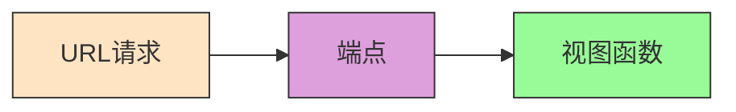
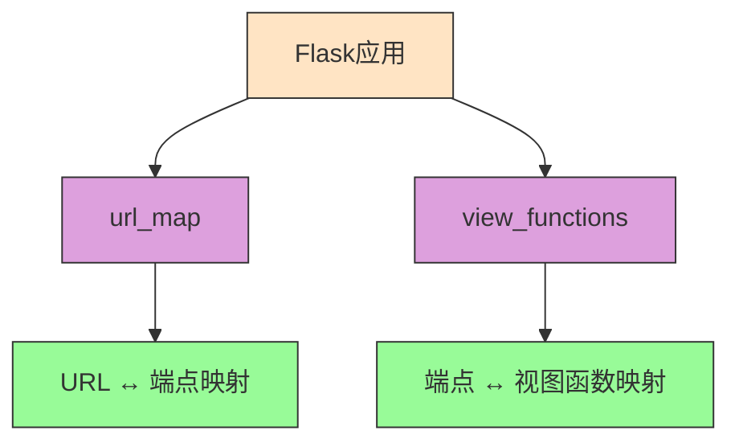
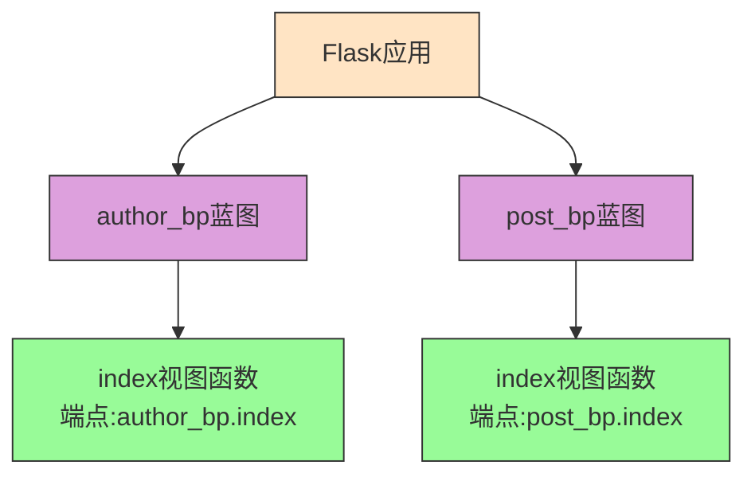
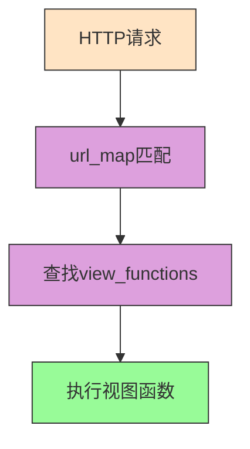

# Flask端点与蓝图详解

## 端点（Endpoint）

端点（**Endpoint**）是URL规则（rule）和视图函数（view_func）之间的中间媒介。它是Flask路由系统的核心概念，用于解耦URL与视图函数之间的直接绑定关系，提供更大的灵活性和可扩展性。



例如：

```python
# 使用装饰器方式定义路由
# @app.route()装饰器是Flask提供的便捷方式，用于将URL规则与视图函数关联
@app.route('/index')
def index():
    # 视图函数返回简单的问候语
    return 'hello,world'

# 等效于使用add_url_rule方法手动添加URL规则
# 这种方式更直观地展示了Flask路由系统的底层实现机制
def index():
    # 视图函数返回简单的问候语
    return 'hello,world'
# add_url_rule(rule, endpoint, view_func)方法参数说明：
# rule: URL路径规则，定义了访问该视图函数的URL路径
# endpoint: 端点名称，默认为视图函数名，用于唯一标识视图函数
# view_func: 处理该URL的视图函数，负责生成HTTP响应
app.add_url_rule('/index', 'index', index)
```

默认情况下，端点（Endpoint）就是视图函数（View Function）的名称。这种设计使得Flask可以通过端点名称唯一标识每个视图函数，无论它们位于哪个模块或蓝图中。

开发者也可以显式地指定端点名称，以满足特定的命名需求或避免命名冲突：

```python
# 显式指定端点名称为'index2'，而不是使用默认的函数名
# 通过endpoint参数可以自定义端点名称，用于解决命名冲突或满足特定需求
@app.route('/', endpoint='index2')
def index():
    # 视图函数的具体实现
    pass
```

---

## 端点、view_functions 与 url_map

在每个Flask应用对象（app）中，有两个重要的属性与端点机制相关：

`view_functions` 存储了端点名称（endpoint）→ 视图函数（view_func）的键值对映射关系。

`url_map` 存储了URL规则与端点名称之间的映射关系。

这两个核心数据结构均由 `add_url_rule` 方法进行维护和更新，构成了Flask路由系统的基础。

```python
# 导入Flask类
from flask import Flask

# 创建Flask应用实例
app = Flask(__name__)

# 定义根路径的视图函数
# 该路由将'/'路径映射到index视图函数，端点名称默认为'index'
@app.route('/')
def index():
    # 返回简单的文本响应
    return 'index'

# 定义/hello路径的视图函数
# 该路由将'/hello'路径映射到hello视图函数，端点名称默认为'hello'
@app.route('/hello')
def hello():
    # 返回简单的文本响应
    return 'hello'

# 应用启动入口
if __name__ == '__main__':
    # 打印view_functions字典，显示端点与视图函数的映射关系
    # 格式：{'端点名称': 视图函数对象}
    print('View Functions:')
    print(app.view_functions)
    print('------------')
    # 打印url_map对象，显示URL规则与端点的映射关系
    # 格式：Map([Rule对象列表])，每个Rule对象包含URL规则和对应的端点
    print('URL Map:')
    print(app.url_map)
    # 启动Flask开发服务器
    app.run(host='localhost', port=5004)
```

输出：

```text
{'static': <bound method _PackageBoundObject.send_static_file of <Flask 'test'>>,
 'index': <function index at 0x104db2310>, 'hello': <function hello at 0x105ae4160>}
------------
Map([<Rule '/hello' (HEAD, GET, OPTIONS) -> hello>,
 <Rule '/' (HEAD, GET, OPTIONS) -> index>,
 <Rule '/static/<filename>' (HEAD, GET, OPTIONS) -> static>])
```

当一个HTTP请求进入Flask应用时，会按照以下流程处理：

1. 首先通过URL规则（Rule）在 `url_map` 中查找对应的端点名称（endpoint）
2. 然后根据端点名称在 `view_functions` 中查找对应的视图函数（view_func）
3. 最终执行找到的视图函数并返回响应结果



---

## 蓝图和端点

当使用蓝图时，端点会变成 `蓝图名.视图函数名`。

**蓝图（Blueprint）**是Flask提供的一个重要特性，它可以将一系列相关的操作组织成一个集合，实现应用的模块化设计。通过蓝图，我们可以将大型应用拆分成多个小的、可重用的组件。

最佳实践：一般情况下，建议在蓝图对象名称后添加 `_bp` 后缀，例如 `user_bp`、`admin_bp`，这样可以在代码中快速识别出哪些是蓝图对象，提高代码可读性和维护性。

蓝图搭配端点的设计，解释了为什么Flask要引入端点机制，而不是直接将URL规则映射到视图函数。

蓝图搭配端点，可以实现蓝图的视图函数命名空间（namespace），有效解决不同模块间视图函数名称冲突的问题。

比如在 `author_bp` 蓝图和 `post_bp` 蓝图中都注册了一个名为 `index` 的视图函数。此时端点 `index` 并不存在，模板中的 `url_for('index')` 会抛出 `BuildError`，必须使用带蓝图前缀的完整端点名。

而通过 `url_for('author_bp.index')` 和 `url_for('post_bp.index')` 这种方式，能够明确指定使用哪个蓝图下的视图函数，有效避免冲突并解决视图函数的重名问题。



---

## 蓝图和 url_prefix

通过上一小节的蓝图端点命名机制，可以有效避免因视图函数名称重复而导致的端点名称冲突问题。

但是如果URL也一样该怎么办呢？

比如 `author_bp` 和 `post_bp` 均注册了相同的URL：

```python
# 在author蓝图中定义根路径视图函数
# 该视图函数在author_bp蓝图中注册，端点名称将自动变为'author_bp.index'
@author_bp.route('/')
def index():
    # 返回author相关的页面内容
    return 'index'

# 在post蓝图中也存在相同的路由，这会导致URL冲突问题
# 该视图函数在post_bp蓝图中注册，端点名称将自动变为'post_bp.index'
# 虽然端点名称不会冲突，但如果不在注册时添加url_prefix，URL路径会冲突
@post_bp.route('/')
def index():
    # 返回post相关的页面内容
    return 'post'
```

如上所示，两个蓝图的端点名称不会重名，但URL路径发生了冲突。这种冲突在注册时不会报错：相同路径的请求永远会路由到先注册的蓝图，冲突路径上后注册的视图无法被访问。

为了避免这种情况，最佳实践是在注册蓝图时填入 `url_prefix` 参数：

```python
# 创建Flask应用实例
app = Flask(__name__)

# 注册author蓝图，并添加URL前缀'/author'
# 这样author蓝图中的所有路由都会加上'/author'前缀
# 例如：@author_bp.route('/')会变成'/author/'路径
app.register_blueprint(author_bp, url_prefix='/author')

# 注册post蓝图，并添加URL前缀'/post'
# 这样post蓝图中的所有路由都会加上'/post'前缀
# 例如：@post_bp.route('/')会变成'/post/'路径
app.register_blueprint(post_bp, url_prefix='/post')
```

添加URL前缀后，两者的实际访问URL变成了：

```text
/author/   # author蓝图的根路径URL
/post/     # post蓝图的根路径URL
```

这样就成功解决了URL路径冲突的问题，同时保持了端点命名的清晰性。

---

## 核心要点总结

1. 端点（Endpoint）机制：端点是连接URL规则和视图函数的桥梁，默认情况下端点名就是视图函数名。

2. Flask路由核心数据结构：Flask应用通过 `url_map` 存储URL规则与端点的映射关系，通过 `view_functions` 存储端点与视图函数的对应关系。

3. 蓝图端点命名空间：使用蓝图（Blueprint）时，端点会自动加上蓝图名前缀（`蓝图名.视图函数名`），有效避免不同蓝图间视图函数重名问题。

4. URL前缀管理：注册蓝图时使用 `url_prefix` 参数可以解决不同蓝图间URL路径冲突的问题，实现URL的层次化管理。

5. 请求处理完整流程：HTTP请求进入 → `url_map` 匹配（URL规则与端点映射）→ `view_functions` 查找（端点与视图函数对应）→ 执行视图函数并返回响应。

6. 蓝图命名规范：推荐为蓝图对象命名时添加 `_bp` 后缀（如 `user_bp`），提高代码可读性和识别度。

7. URL规则添加方式：可以通过 `app.add_url_rule(rule, endpoint, view_func)` 显式地添加URL规则，这是装饰器 `@app.route()` 的底层实现方式。



蓝图的端点命名和 `url_prefix` 在注册蓝图时就已经并入URL规则，请求处理阶段不需要再单独解析。
