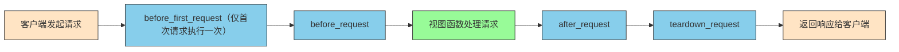

# Flask请求钩子

**请求钩子**（Request Hook）是在客户端与服务器交互过程中，统一处理准备工作或扫尾工作的机制。

## APP层的请求钩子

常见的请求钩子：

- `before_first_request`：在处理第一个请求前运行（Flask 2.2弃用、2.3移除）。
- `before_request`：在每次请求前运行。
- `after_request`：在每次请求完成后运行（Flask 1.1.0起出现未处理异常时也会执行）。
- `teardown_request`：在每次请求结束后运行，即使存在未捕获的异常也会执行。

注意：`before_first_request` 在Flask 2.2起弃用、2.3起移除，在Flask 2.3及以上版本中运行下面的示例会直接报 `AttributeError`。这种写法只适用于旧版本的Flask，新代码的初始化逻辑可以改为在创建应用时执行。

```python
# 从flask框架导入Flask类、url_for函数和redirect函数
# Flask是主要的应用类，用于创建Web应用实例
# url_for用于生成URL，redirect用于重定向
from flask import Flask, url_for, redirect

# 创建Flask应用实例，__name__表示当前模块名称
# __name__作为参数传递给Flask构造函数，用于确定应用的根路径和调试模式等
app = Flask(__name__)

# 定义路由/index，当访问该路径时会触发index函数
@app.route('/index')
def index():
    # 故意制造除零异常，用于测试异常处理
    a = 1 / 0
    # 返回响应内容
    return 'run index'

# 定义路由/hello，当访问该路径时会触发hello函数
@app.route('/hello')
def hello():
    # 返回简单的问候语
    return 'hello'

# 注册before_first_request钩子，在处理第一个请求前运行
# 该钩子函数只会在应用启动后接收到的第一个请求前执行一次
# 通常用于初始化操作，如加载配置、建立数据库连接等
@app.before_first_request
def b_f_r():
    # 打印提示信息，表示第一个请求前的准备工作
    # 这里只是简单打印信息，实际应用中可能会进行更复杂的初始化
    print('before_first_request')

# 注册before_request钩子，在每次请求前运行
@app.before_request
def b_r():
    # 打印提示信息，表示每次请求前的准备工作
    print('before_request')

# 定义路由/handle_request，当访问该路径时会触发handle_request函数
@app.route('/handle_request')
def handle_request():
    # 打印处理请求的信息
    print('处理请求')
    # 打印重定向信息
    print('重定向到/h路径，测试404界面')
    # 重定向到不存在的/h路径，用于测试404页面
    return redirect('/h')

# 注册after_request钩子，在每次请求后运行
# 接收response参数，表示HTTP响应对象
# 该钩子用于在视图函数处理完请求后，返回响应给客户端前进行最后的处理
@app.after_request
def a_r(response):
    # 打印提示信息，表示请求后的处理工作
    print('after_request')
    # 必须返回response对象，可以是原始响应或修改后的响应
    # 可以在此处修改响应头、压缩响应内容等
    return response

# 注册teardown_request钩子，在每次请求后运行，即使有未处理的异常也会执行
# 接收exception参数，记录请求处理过程中的异常信息
# 无论请求处理成功与否，该钩子都会执行，用于资源清理工作
@app.teardown_request
def t_r(exception):
    # 打印提示信息，表示请求结束后的清理工作
    print('teardown_request')
    # 打印分隔线，标识请求处理流程结束
    print('======请求结束=======')
    # teardown函数的返回值会被Flask忽略，不能通过返回值传递响应或异常
    # 实际应用中，这里常用于关闭数据库连接、释放文件锁等资源清理操作

# 程序入口点，当直接运行此脚本时执行
if __name__ == '__main__':
    # 启动Flask开发服务器，监听本地5006端口
    app.run(host='localhost', port=5006)
```

输出如下：

```text
before_first_request
before_request
处理请求
重定向到/h路径，测试404界面
after_request
teardown_request
======请求结束======
127.0.0.1 - - [05/Nov/2020 10:20:05] "GET /handle_request HTTP/1.1" 302 -
127.0.0.1 - - [05/Nov/2020 10:20:05] "GET /h HTTP/1.1" 404 -
before_request
after_request
teardown_request
======请求结束======
```

### Flask请求钩子执行流程图

下面的流程图展示了Flask请求钩子的执行顺序：



值得注意的是，`after_request` 在遇到未捕获异常时的行为随版本变过几次：

- Flask 0.4起，请求因异常终止、错误处理页面介入时，`after_request` 也会被执行；
- Flask 0.7改变了这一行为：出现未处理异常时 `after_request` 不再执行，同时新增了无论是否出现异常都会执行的 `teardown_request`（[相关 issue](https://github.com/pallets/flask/issues/174)）；
- Flask 1.1.0起，对未处理的异常也会调用 `finalize_request`，`after_request` 恢复执行。

不少文章提到了这个行为，但往往没有注明适用的版本范围。

下面是文档介绍：

> `after_request(*args, **kwargs)`
>
> Register a function to be run after each request. Your function must take one parameter, a [`response_class`](http://docs.jinkan.org/docs/flask/api.html#flask.Flask.response_class) object and return a new response object or the same (see [`process_response()`](http://docs.jinkan.org/docs/flask/api.html#flask.Flask.process_response)).
>
> As of Flask 0.7 this function might not be executed at the end of the request in case an unhandled exception occurred.

---

这段介绍出自旧版（0.10.1）文档。这里的 “as of” 就是“从……起”的意思，不是“截止”：从Flask 0.7起，如果请求过程中出现未处理异常，这个函数可能不会在请求结束时执行，对应上面0.7–1.0的行为。

经测试验证，在请求处理函数中人为触发异常后，`after_request` 仍然正常执行（上面的输出中没有触发异常的请求，未访问/index，这一结论来自对异常请求的单独测试）。这与旧文档的描述并不矛盾：从Flask 1.1.0起，未处理异常时也会调用 `finalize_request`，`after_request` 恢复执行，这里测试所用的版本在1.1.0以上。

既然 `after_request` 和 `teardown_request` 都在请求结束后执行，它们的区别是什么呢？

根据官方文档，两者的主要区别如下：

1. **after_request** 必须接收一个 **response 对象**作为参数，并且必须返回一个 **response 对象**。
2. **after_request** 通常用于统一修改响应内容，例如**修改响应头**。
3. **teardown_request** 接收一个异常参数，用于记录请求处理过程中的异常信息。
4. **teardown_request** 通常用于**释放程序占用的资源**，例如关闭数据库连接。

---

## 蓝图层的请求钩子

和APP层类似，蓝图层的常用钩子如下：

- `before_app_request`
- `after_app_request`
- `teardown_app_request`

> Such a function is executed after each request, even if outside of the blueprint.

这句英文出自前面引用的那份旧版（0.10.1）中文文档，是 `after_app_request` 条目下的说明：`after_app_request` 与 `after_request` 类似，但作用于蓝图；通过它注册的函数会在每个请求结束后执行，即使请求落在该蓝图之外。

## 核心要点总结

使用请求钩子时需要注意版本：`before_first_request` 在Flask 2.2弃用、2.3移除，初始化逻辑可以改为创建应用时执行；`after_request` 在未处理异常时的行为经历过几次变化（0.7–1.0期间不执行，1.1.0起恢复执行），查阅资料时注意其对应的Flask版本。
