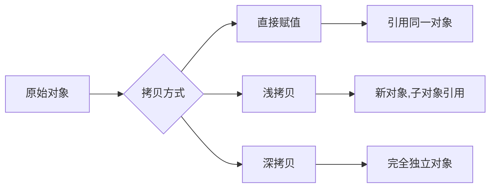

# Python 拷贝机制详解：直接赋值、浅拷贝与深拷贝的原理与应用

## 三种拷贝方式

- **直接赋值：** 其实就是对象的引用（别名），不创建新对象。
- **浅拷贝（copy）：** 拷贝父对象，不会拷贝对象内部的子对象。
- **深拷贝（deepcopy）：** 使用 copy 模块的 deepcopy 方法，完全拷贝父对象及其子对象。

**1. b = a：赋值引用**，a 和 b 都指向同一个对象。


**2. b = a.copy()：浅拷贝**，a 和 b 是独立的对象，但它们的子对象仍然指向同一对象（即子对象仍为引用）。


**3. b = copy.deepcopy(a)：深拷贝**，完整拷贝父对象及其所有子对象，a 和 b 完全独立。


## 更多实例

以下实例使用 copy 模块的 `copy.copy`（浅拷贝）和 `copy.deepcopy`（深拷贝）：

```python
#!/usr/bin/python
# -*- coding: utf-8 -*-

# 导入 copy 模块，用于实现浅拷贝和深拷贝功能
import copy

# 创建一个包含嵌套结构的原始对象
# 包含整数元素 1, 2, 3, 4 和一个嵌套列表 ['a', 'b']
a = [1, 2, 3, 4, ['a', 'b']]  # 原始对象

# 多种不同的拷贝方式演示
b = a                         # 赋值引用，b 与 a 指向同一对象
c = copy.copy(a)              # 浅拷贝，创建新的列表对象，但嵌套对象仍为引用
d = copy.deepcopy(a)          # 深拷贝，递归拷贝所有层级的对象，完全独立

# 修改原始对象 a，观察不同拷贝方式的区别
a.append(5)                   # 在 a 末尾添加元素5
a[4].append('c')              # 在 a 的嵌套列表 ['a', 'b'] 中添加元素 'c'

# 打印各个对象的值，验证拷贝效果
print('a = ', a)              # 输出修改后的 a
print('b = ', b)              # 输出 b，由于是引用，会同步 a 的所有修改
print('c = ', c)              # 输出 c，浅拷贝对象，顶级元素独立但嵌套对象共享
print('d = ', d)              # 输出 d，深拷贝对象，完全独立不受影响
```

输出结果为：

```text
a =  [1, 2, 3, 4, ['a', 'b', 'c'], 5]
b =  [1, 2, 3, 4, ['a', 'b', 'c'], 5]
c =  [1, 2, 3, 4, ['a', 'b', 'c']]
d =  [1, 2, 3, 4, ['a', 'b']]
```

## 查漏补缺

为什么 Python 默认的拷贝方式是**浅拷贝**？

- **时间角度**：浅拷贝花费时间更少
- **空间角度**：浅拷贝花费内存更少
- **效率角度**：浅拷贝只拷贝顶层数据，一般情况下比深拷贝效率高

**知识点总结：**

- **不可变对象**被修改（重新赋值）时，变量会指向新开辟的空间，原对象与其他引用不受影响
- **可变对象**在赋值时，修改其中一个变量的值，另一个变量也会随之变化
- **深拷贝**、**浅拷贝**对**不可变对象**拷贝时，不开辟新空间，相当于赋值操作
- **浅拷贝**在拷贝时，只拷贝第一层中的引用，如果元素是**可变对象**并且被修改，那么拷贝的对象也会发生变化
- **深拷贝**在拷贝时会逐层进行拷贝，直到所有的引用都是**不可变对象**为止
- Python 中有多种方式实现**浅拷贝**：`copy` 模块的 `copy` 函数、对象自带的 `copy` 方法、工厂函数、切片操作等
- 大多数情况下，编写程序时都是使用**浅拷贝**，除非有特定的需求
- **浅拷贝**的优点：拷贝速度快，占用空间少，拷贝效率高

## 拷贝方式对比流程图

下面用 mermaid 图表展示三种拷贝方式的核心区别：



## 核心要点总结

1. **直接赋值（引用）**：不创建新对象，只是给对象增加一个新的引用名称，所有引用共享同一内存地址。

2. **浅拷贝**：创建一个新的对象，但对于对象中的元素，仅拷贝其引用，而非完整拷贝元素对象本身。

3. **深拷贝**：递归地拷贝所有层级的对象，创建全新的对象和其包含的所有子对象，完全独立于原对象。

4. **不可变对象与拷贝**：对于字符串、元组等不可变对象，深浅拷贝都不会创建新对象，实际效果等同于引用。

5. **可变对象与拷贝**：列表、字典等可变对象在浅拷贝时，顶层对象独立，但内层嵌套对象仍然共享引用。

6. **适用场景**：浅拷贝适用于大多数场景，具有性能优势；深拷贝适用于需要完全隔离对象的场景，但开销较大。

## 参考来源

- [Python 直接赋值、浅拷贝和深度拷贝解析](https://www.runoob.com/w3cnote/python-understanding-dict-copy-shallow-or-deep.html)
- [Python 程序员如何防止数据被修改？](https://baijiahao.baidu.com/s?id=1627356407968660842&wfr=spider&for=pc)
