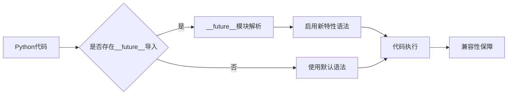

# Python `__future__` 模块详解：实现新旧版本兼容的关键技术

当需要在旧版本 Python 中使用新版本的某些特性时，例如需要同时兼容 Python 2 和 Python 3，就需要使用 `__future__` 模块。

该模块于 Python 2.1 版本中被引入。

官方文档链接：[`__future__` 模块官方文档](https://docs.python.org/3.9/library/__future__.html?highlight=__future__#module-__future__)

在官方文档里提到引入这个模块的三个核心目的：

> [`__future__`](https://docs.python.org/3.9/library/__future__.html?highlight=__future__#module-__future__) is a real module, and serves three purposes:
>
> * To avoid confusing existing tools that analyze import statements and expect to find the modules they're importing.
> * To ensure that [future statements](https://docs.python.org/3.9/reference/simple_stmts.html#future) run under releases prior to 2.1 at least yield runtime exceptions (the import of [`__future__`](https://docs.python.org/3.9/library/__future__.html?highlight=__future__#module-__future__) will fail, because there was no module of that name prior to 2.1).
> * To document when incompatible changes were introduced, and when they will be — or were — made mandatory. This is a form of executable documentation, and can be inspected programmatically via importing [`__future__`](https://docs.python.org/3.9/library/__future__.html?highlight=__future__#module-__future__) and examining its contents.

中文翻译如下：

> 1. 为了避免影响现有的导入分析工具
> 2. 为了保证低于 2.1 版本时能够报导入错误
> 3. 记录不兼容更改的引入时间（可选阶段），以及何时将其设定为语言的强制特性（强制阶段）

为了更好地理解 `__future__` 模块的工作原理，我们可以通过以下流程图来可视化其工作机制：



---

在使用 `__future__` 模块后，即可在旧版本中使用新版本的特性。例如在 Python 2 环境中导入 `print_function`，就可以使用 Python 3 的 `print()` 函数语法。

```python
# 导入 __future__ 模块中的 print_function 特性
# 使得在 Python 2 环境中也能使用 Python 3 的 print() 函数语法
from __future__ import print_function

# 使用 print() 函数输出文本
print('hello, world')
```

完整的特性列表如下：

| feature | optional in | mandatory in | effect | 说明 |
| :--- | :--- | :--- | :--- | :--- |
| nested_scopes | 2.1.0b1 | 2.2 | [PEP 227](https://www.python.org/dev/peps/pep-0227): *Statically Nested Scopes* | 静态嵌套作用域 |
| generators | 2.2.0a1 | 2.3 | [PEP 255](https://www.python.org/dev/peps/pep-0255): *Simple Generators* | 生成器 |
| division | 2.2.0a2 | 3.0 | [PEP 238](https://www.python.org/dev/peps/pep-0238): *Changing the Division Operator* | 精确除法（3/4 = 0.75） |
| absolute_import | 2.5.0a1 | 3.0 | [PEP 328](https://www.python.org/dev/peps/pep-0328): *Imports: Multi-Line and Absolute/Relative* | 绝对导入 |
| with_statement | 2.5.0a1 | 2.6 | [PEP 343](https://www.python.org/dev/peps/pep-0343): *The "with" Statement* | with 语句 |
| print_function | 2.6.0a2 | 3.0 | [PEP 3105](https://www.python.org/dev/peps/pep-3105): *Make print a function* | print() 函数 |
| unicode_literals | 2.6.0a2 | 3.0 | [PEP 3112](https://www.python.org/dev/peps/pep-3112): *Bytes literals in Python 3000* | Unicode 字面量 |
| generator_stop | 3.5.0b1 | 3.7 | [PEP 479](https://www.python.org/dev/peps/pep-0479): *StopIteration handling inside generators* | 生成器中 StopIteration 处理 |
| annotations | 3.7.0b1 | 3.10 | [PEP 563](https://www.python.org/dev/peps/pep-0563): *Postponed evaluation of annotations* | 延迟注解求值 |

注：表中 annotations 一行的 mandatory in “3.10” 取自 Python 3.9 文档的旧版数据。实际上 PEP 563 的强制生效计划被推迟并最终取消——现行 Python 文档已把该值改为 “Never”，并注明这一特性将来会废弃移除（参见 PEP 649/749）。`from __future__ import annotations` 至今仍是可选特性。

## 核心要点总结

1. **`__future__` 模块的作用**：允许在旧版本 Python 中使用新版本的特性，让同一份代码在新旧两个版本上都能运行。

2. **引入目的**：避免影响现有导入工具、确保低版本报错以及记录不兼容更改的引入和强制时间。

3. **常用特性导入**：如 `print_function` 可在 Python 2 中使用 Python 3 的 `print()` 函数语法。

4. **关键特性列表**：`nested_scopes`、`generators`、`division`、`absolute_import`、`with_statement`、`print_function` 等。

5. **版本兼容性**：每个特性都有对应的可选版本和强制版本，需要根据目标运行环境选择合适的特性导入。

6. **实际应用场景**：主要用于 Python 2 到 Python 3 的迁移过程中，确保代码在两个版本间保持兼容。
