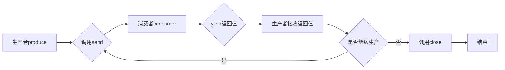

# 协程详解：从 yield 到 yield from

## 协程是什么？

**协程**（coroutine），又称微线程，在一个线程中执行。

**进程**是分配和管理资源的最小单位。

**线程**是分配和管理 CPU 的最小单位，与同属一个进程的其他线程共享所拥有的全部资源。

和多线程相比，**协程**的优势在于：

1. **极高的执行效率**。子程序切换由程序自身控制，而非线程切换，因此没有线程切换带来的开销。线程数越多，协程相比多线程的性能优势越明显。
2. **不需要多线程的锁机制**。由于不存在同时写变量的冲突，共享资源无需加锁，只需判断状态即可。

协程可以通过**多进程 + 协程**的方法利用多核 CPU。

### yield 可以实现协程

当一个函数中存在 **yield** 时，这个函数就是一个**生成器**。

**yield** 的两个核心特点：

1. 产出一个值，并暂停函数的执行（保存现场）
2. 接收调用者通过 `send()` 方法传入的参数

这使得 **yield** 实现的生成器具有中断等待的功能，从而实现协程。

### yield 实现协程的例子

```python
def consumer():
    r = ''  # 初始化返回值为空字符串
    while True:  # 无限循环，持续消费生产者发送的数据
        n = yield r  # 初始化后，中断在 yield r。使用 send 方法传入数据后，yield 返回该数据
        if not n:  # 如果接收到的数据为空，则退出循环
            return
        print('[消费者] 正在消费:{0}'.format(n))  # 打印正在消费的数据
        r = '200 人民币'  # 设置返回值为 '200 人民币'

def produce(c):  # 生产者函数
    c.send(None)  # 启动消费者（生成器），进行初始化
    n = 0  # 初始化计数器
    while n < 5:  # 循环5次生产数据
        n = n + 1  # 计数器加1
        print('[生产者] 正在生产:{0}'.format(n))  # 打印正在生产的商品编号
        r = c.send(n)  # 调用 send 方法，将商品编号传入消费者协程，同时接收消费者返回的结果
        print('[生产者] 消费者返回:{0}'.format(r))  # 打印消费者返回的结果
        print('-------------------------------------------------')
    c.close()  # 关闭消费者生成器

c = consumer()  # 构造一个消费者生成器
produce(c)  # 启动生产者
```

为了更直观地理解 yield 实现的协程工作原理，我们可以用下面的流程图来表示生产者-消费者模型的执行过程：



### yield 实现协程的不足

每次只能向直接调用者返回一个值，导致无法分离到一个单独的函数中，**复用性差**。

## 协程的状态查看

- **GEN_CREATED**：等待执行，还没有进入协程
- **GEN_RUNNING**：解释器正在执行
- **GEN_SUSPENDED**：阻塞状态，在 yield 处暂停
- **GEN_CLOSED**：执行结束

可以通过 `inspect.getgeneratorstate()` 函数来查看。

---

## yield from

- Python 3.3 通过 PEP 380 引入了 `yield from` 语法，允许一个生成器将其部分操作委派给另一个生成器。其主要动机是使生成器能够方便地拆分为多个拥有 `send()` 和 `throw()` 方法的子生成器，就像一个大函数可以轻松拆分为多个子函数一样。Python 的生成器是**协程**（coroutine）的一种形式，但其局限在于只能向直接调用者 yield 值，这意味着包含 `yield` 的代码不能像普通代码那样被提取到独立的函数中。`yield from` 正是为了解决这一问题而设计的。
- 虽然 `yield from` 主要用于向**子生成器**委派操作，但它实际上可以向任意可迭代对象委派操作。

**yield** 每次只能产出一个值，而 **yield from** 可以产出来自另一个可迭代对象的所有值。

在 PEP 380 中使用了一些 `yield from` 的专门术语：

- **委派生成器**：包含 `yield from <iterable>` 表达式的生成器函数
- **子生成器**：从 `yield from` 表达式中 `<iterable>` 部分获取的生成器
- **调用方**：调用委派生成器的客户端代码


委派生成器在 `yield from` 表达式处暂停时，调用方可以直接把数据发给子生成器，子生成器再把结果直接发回给调用方。子生成器返回之后，解释器会抛出 StopIteration 异常，并把返回值附加到异常对象上，此时委派生成器会恢复。

```python
# yield from list 等效于：
for item in list:
    yield item
```

### yield from 所实现的数据传输通道

`yield from` 在调用方和子生成器之间建立了一个双向通道：

- 调用方通过 `send()` 发送的数据可以直接到达子生成器
- 子生成器通过 `yield` 产出的值可以直接返回给调用方
- 子生成器的 `return` 值会通过 `StopIteration` 异常传递给委派生成器

## 核心要点总结

1. **协程**是一种轻量级的并发编程方式，相比多线程具有更高的执行效率和更低的资源消耗。

2. **yield** 关键字可以让函数变成生成器，实现基本的协程功能，通过 `send()` 方法在生产者和消费者之间传递数据。

3. **yield from** 是 yield 的增强语法，能够委派操作给子生成器，解决了 yield 复用性差的问题。

4. 协程有四种状态：**GEN_CREATED**（等待执行）、**GEN_RUNNING**（正在执行）、**GEN_SUSPENDED**（暂停状态）和 **GEN_CLOSED**（执行结束）。

5. 协程的主要优势包括：**极高的执行效率**、**无需多线程锁机制**以及可以结合多进程利用多核 CPU。

6. 通过 `inspect.getgeneratorstate()` 函数可以查看协程的当前状态。
