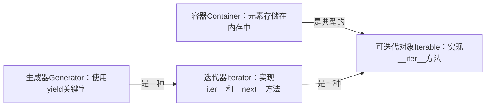

# Python 容器、可迭代对象、迭代器与生成器

梳理可迭代对象、迭代器、生成器之间的联系。


---

## 概念关系图



## 容器（Container）

1. **容器**是一个存储多个元素的数据结构。
2. 容器中的元素可以通过迭代获取。
3. 所有容器中的元素被存放在内存中。
4. 常见的容器如 list、tuple、dict、set、str，也都是**可迭代对象**（Iterable）。

```python
from collections.abc import Iterable
a = ['test', 'test2']  # 创建一个包含两个字符串元素的列表
for i in a:  # 通过 for 循环迭代获取列表中的每个元素
    print(i)  # 打印当前元素
print(isinstance(a, Iterable))  # 检查列表 a 是否为可迭代对象，返回 True
```

---

## 可迭代对象（Iterable）

**可迭代对象**是可以被迭代获取的对象。

内部定义了可返回迭代器的 `__iter__()` 方法。

例如：

```python
x = [1, 2, 3]  # 创建一个包含三个整数的列表
for elem in x:  # 遍历列表中的每个元素
    print(elem)  # 打印当前元素
```

`x` 列表是一个可迭代对象，for 循环先调用 `iter(x)` 获得迭代器，再反复对迭代器调用 `next()` 取出元素，即 `it = iter(x); elem = next(it)`。

---

## 迭代器（Iterator）

**迭代器**是一个**带状态**的对象，该状态用于记录当前迭代所在位置，以方便下次迭代的时候获取正确的元素。

Iterator 实现了 `__iter__` 和 `__next__` 方法。

迭代器不会一次性把所有的元素都加载到内存，而是**在需要的时候才会生成返回结果**。

1. 可迭代对象 != 迭代器
2. 迭代器带状态
3. 迭代器不会直接加载所有数据到内存

---

## 生成器（Generator）

**生成器**是一种特殊的迭代器。

调用方可以通过 `send()` 方法向生成器传入数据，生成器根据传入的值计算并返回结果。

### 生成器函数（Generator Function）

含有 `yield` 关键字的函数就是生成器函数。

```python
def d():
    print('第一次调用')
    sum = 0
    # 第一次 c.send(None) 只执行到 yield sum
    # 再次进入时，send() 传入的值作为 yield 表达式的结果赋给 value
    value = yield sum
    sum = value + sum
    print('sum的值为:%d' % sum)
    print('value:%d' % value)  # 输出 value:1
    # c.send(1) 只执行到 yield sum，再次进入时执行 value = 2
    value = yield sum
    print('value:%d' % value)  # 输出 value:2
    yield sum
    

c = d()  # 创建生成器对象，此时函数并未执行
d = c.send(None)  # 启动生成器，执行到第一个 yield，返回 sum 的值并赋值给 d
print('生成器传出的值为%d' % d)
d = c.send(1)  # 传入数值1，通过 yield 传递给 value，继续执行到第二个 yield
print('第二次调用返回值为%d' % d)
d = c.send(2)  # 传入数值2，继续执行到第三个 yield
print('第三次调用返回值为%d' % d)
```

可以看到，`yield` 将 `sum` 的值传递给了调用方，将 `send()` 方法递进来的 `1` 传递给了 `value`。生成器在 `yield` 处中断并保存状态，恢复时从中断处继续。

### 生成器表达式（Generator Expression）

生成器表达式是列表推导式的生成器版本，返回一个生成器对象。

```python
from collections.abc import Iterator
a = (x * x for x in range(10))  # 创建一个生成器表达式，计算 0-9 的平方
print(isinstance(a, Iterator))   # 检查 a 是否为迭代器对象，返回 True
for x in a:                     # 遍历生成器中的每个值
    print(x)                     # 打印当前值
```

### 生成器的优势

**延迟加载**：在处理长序列问题时，更加节省存储空间。

比如打印一个斐波那契数列，原始方法如下：

```python
def fab(max):
    n, a, b = 0, 0, 1   # 初始化计数器 n 和斐波那契数列的前两个数 a, b
    L = []               # 创建空列表存储斐波那契数列
    while n < max:       # 当计数器小于最大值时继续循环
        L.append(b)      # 将当前斐波那契数添加到列表中
        a, b = b, a + b  # 计算下一个斐波那契数
        n += 1           # 计数器加1
    return L             # 返回完整的斐波那契数列
print(fab(20))          # 打印前20个斐波那契数
```

所有元素都存放在列表 L 里，空间开销较大。

使用生成器的方法如下：

```python
def fab(max):
    n, a, b = 0, 0, 1     # 初始化计数器 n 和斐波那契数列的前两个数 a, b
    while n < max:         # 当计数器小于最大值时继续循环
        yield b            # 每次在这里中断，把 b 的值传递给 i，同时保存中断时的状态
        a, b = b, a + b    # 计算下一个斐波那契数
        n += 1             # 计数器加1
for i in fab(20):          # 使用生成器遍历前20个斐波那契数
    print(i)               # 打印当前斐波那契数
```

这种方法不需要额外的列表空间开销。

### send() 方法的交互

```python
def my_generator(n):
    for i in range(n):     # 循环 n 次
        yield i            # 依次产出 0 到 n-1 的数字
g = my_generator(5)        # 创建生成器对象，可产出 0-4 的数字
print(next(g))             # 获取下一个值，输出0
print(next(g))             # 获取下一个值，输出1
print(g.send(100))         # 发送数据100，但仍然返回下一个值2
print(next(g))             # 获取下一个值，输出3
print(next(g))             # 获取下一个值，输出4
```

可以看到第7行的 `g.send()` 方法输出了本来 `next()` 方法应该输出的 2。

1. `send()` 的主要作用是当需要手动更改生成器里面的某一个值并且使用它时，把数据交给 `yield` 表达式（即赋给 `value = yield ...` 中的 `value`），以供后续使用。
2. `send()` 的返回值就是本来应该被迭代出来的值。这样既可以保证能够传入新的值，原来的值也不会丢失。

---

## 总结

| 对象 | 特点 | 功能 |
| --- | --- | --- |
| Iterable | 实现了 `__iter__()` 方法 | 返回一个 Iterator |
| Iterator | 实现了 `__iter__()` 和 `__next__()` 方法，按需逐个产出元素 | 逐个传出数据 |
| Generator | `yield` 替换了 `__next__()` 方法，可以中断，保存了状态的迭代器 | 逐个传入/传出数据 |
| Container | 元素都存储在内存中，元素可以通过迭代获取 | 存储数据 |

## 核心要点总结

1. **容器（Container）**：存储多个元素的数据结构，所有元素都被存放在内存中，常见的容器包括 list、tuple、dict、set、str 等。

2. **可迭代对象（Iterable）**：可通过迭代获取的对象，内部定义了可返回迭代器的 `__iter__()` 方法。

3. **迭代器（Iterator）**：带状态的对象，实现了 `__iter__()` 和 `__next__()` 方法，不会一次性加载所有元素到内存，在需要时才会生成返回结果。

4. **生成器（Generator）**：一种特殊的迭代器，使用 `yield` 关键字，可以中断并保存状态，支持传入数据进行计算。

5. **生成器函数**：包含 `yield` 关键字的函数，每次调用会返回一个生成器对象。

6. **生成器表达式**：列表推导式的生成器版本，返回一个生成器对象，具有延迟加载的特性。

7. **send() 方法**：用于向生成器传入数据并获取下一个值，实现生成器与调用方的数据交互。
