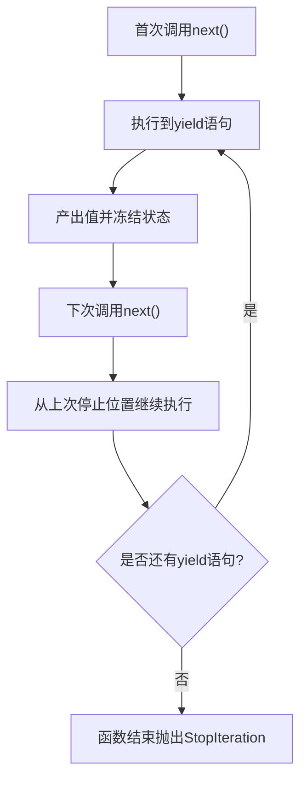
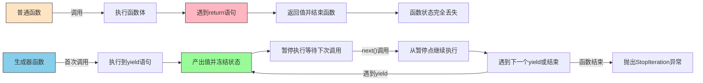

# 深入理解Python生成器：高效内存管理的利器

生成器可以动态地生成后续元素，这些值基于某种算法推算得出。由于在需要时才生成，使用生成器可以节省内存空间。

在 Python 中，这种一边循环一边计算的机制称为**生成器**（generator）。

## 创建 generator

### 将列表推导式的 `[]` 改为 `()`

只要将列表推导式的 `[]` 改为 `()`，就创建了一个 generator：

```python
>>> L = [x*x for x in range(10)]  # 创建一个列表推导式，生成0到9的平方数列表
>>> L
[0, 1, 4, 9, 16, 25, 36, 49, 64, 81]
>>> g = (x*x for x in range(10))  # 将列表推导式的方括号改为圆括号，创建生成器
>>> g
<generator object <genexpr> at 0x1022ef630>
```

`L` 是一个 list，而 `g` 是一个 generator。

通过 `next()` 函数，可以获取 generator 的下一个返回值，即按照设定的算法生成后续序列。

通常，我们会使用 for 循环来迭代 generator：

```python
>>> g = (x*x for x in range(10))  # 创建一个生成器对象
>>> for n in g:  # 使用for循环迭代生成器
...     print(n)  # 逐个打印生成器产生的值
```

## yield

有些函数也可以用算法逐个算出序列的值，但只要函数定义中没有 yield，它就只是普通函数，而不是生成器。

yield 取代了 return，用于产出函数的返回值。

如果一个函数定义包含关键字 **yield**，那么这个函数就不再是一个普通的函数，而是一个 **generator**。

## yield 与 return 的区别

当一个生成器函数执行到 yield 语句时，函数的“状态”会被**冻结**：所有变量的值会被保留下来，下一行要执行的代码位置也会被记录，直到下次调用 `next()`。一旦 `next()` 再次被调用，生成器函数会从上次暂停的位置继续执行。

下面通过一个简单的流程图来展示生成器函数的工作原理：



为了更好地理解生成器与普通函数的区别，我们可以通过下面的对比图来说明：



## 例子

杨辉三角问题：

1. 每个数等于其上方两数之和。
2. 每行数字左右对称，从 1 开始逐渐递增。

下面是我的代码：

```python
def triangles():
    n = 0  # 初始化行号计数器
    while True:  # 无限循环生成杨辉三角
        if n == 0:  # 处理第一行，只有一个元素1
            L2 = [1]
            yield L2.copy()  # 产出第一行
        elif n == 1:  # 处理第二行，有两个元素1
            L2 = [1, 1]
            yield L2.copy()  # 产出第二行
        else:  # 处理后续行
            L = L2.copy()  # 复制上一行数据，避免引用问题
            i = 0
            while i < n - 1:  # 计算中间的数值
                L2[i + 1] = L[i] + L[i + 1]  # 当前位置的值等于上一行相邻两数之和
                i = i + 1
            L2.append(1)  # 每行末尾添加1
            yield L2.copy()  # 产出当前行
        n += 1  # 行号递增

# 使用示例
n = 0
for t in triangles():  # 迭代生成器函数
    print(t)  # 打印每一行
    n = n + 1
    if n == 10:  # 控制只输出前10行
        break
```

在代码中，还有一个值得注意的地方：上面三处 `yield` 产出的都是 `L2.copy()`，而不是 `L2` 本身。`yield` 并不会复制列表，如果直接 `yield L2`，生成器下一轮迭代还会原地修改这个列表；按 `list(itertools.islice(triangles(), 4))` 这类常见写法把各行保存下来时，保存的行可能指向同一个列表，内容会被后续迭代覆盖。下面两个参考实现里的 `yield L[:]` 和 `yield ret[:]` 也是同样的道理。

`L = L2` 只是引用别名，并不会创建新对象；如果不希望两个 list 之间的修改相互影响，可以用 `L.copy()` 创建浅拷贝，对本例这样的一维数字列表已经足够，嵌套结构才需要用 `copy.deepcopy()` 实现深拷贝。

另外，上述代码带有较明显的 C 风格。以下是其他同学更 Pythonic 的实现方式，值得参考：

```python
def triangles():
    L = [1]  # 初始化第一行
    while True:  # 无限循环，持续生成下一行
        yield L[:]  # 产出当前行
        L.append(0)  # 在列表末尾添加0，便于计算
        # 通过列表推导式生成下一行：每个元素等于当前位置和前一个位置元素之和
        L = [L[i - 1] + L[i] for i in range(len(L))]
```

还有另一种写法：

```python
def triangles():
    ret = [1]  # 初始化第一行
    pre = ret[:]  # 复制当前行作为下一次计算的基准
    while True:  # 无限循环，持续生成下一行
        yield ret[:]  # 产出当前行
        for i in range(1, len(ret)):  # 从第二个元素开始计算
            ret[i] = pre[i] + pre[i - 1]  # 当前位置值等于上一行相邻两数之和
        ret.append(1)  # 行尾添加1
        pre = ret[:]  # 复制当前行作为下一次计算的基准
```

## 总结

* generator 是用来产生一系列值的
* yield 向调用者产出结果，同时保存 generator 的状态
* generator 是特殊类型的迭代器
* 可以通过 `next()` 来获取 generator 的下一个值
* 通常使用 for 循环来迭代 generator，隐式调用 `next()` 逐个获取值，可避免手动调用 `next()` 可能引发的 `StopIteration` 异常
* 生成器按需生成数据，特别适用于处理大量数据或无限序列的场景
